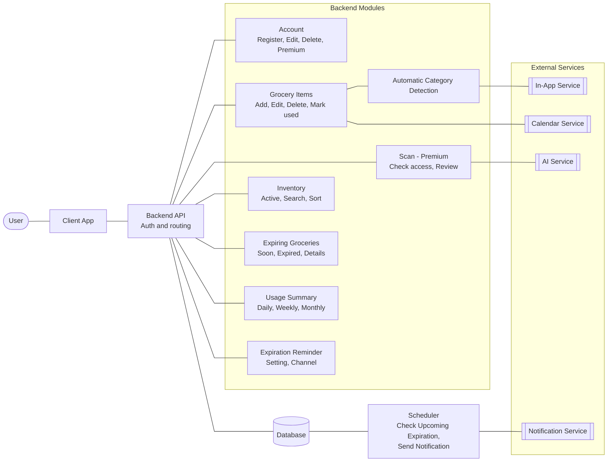

## Architecture diagram

The user works through the client app, which talks to the backend API. The API routes each request to the module for that group of use cases, and the modules store their data in the database. A scheduler checks upcoming expirations and sends notifications on its own. Calendar, AI, In-App and Notification services are external and may be unavailable or require configuration.

Each backend module is one use case group from the use case diagram. Each external service connects only where it does in that diagram: Calendar to item entry and editing, AI to scanning, In-App to category detection, and Notification to the expiration check. Scan and Reminder settings are Premium features, so the Account module checks the user's plan before allowing them.
